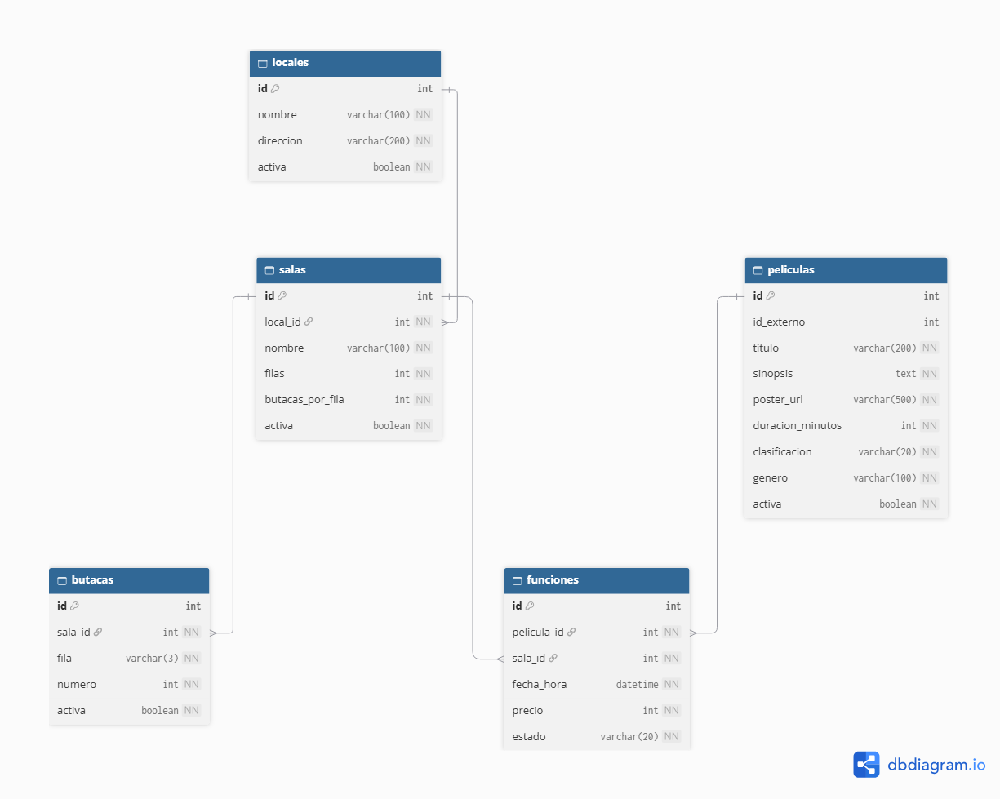

# Modelo de datos - Cine Paradiso

## Cartelera y salas

Este modelo de datos representa la estructura necesaria para gestionar los locales, salas, butacas, películas y funciones del sistema Cine Paradiso.

### Tablas del modelo

- **Locales:** almacena los datos de cada establecimiento.
- **Salas:** representa las salas pertenecientes a cada local.
- **Butacas:** identifica las butacas de cada sala.
- **Películas:** almacena la información de las películas.
- **Funciones:** relaciona las películas con las salas, fechas, horarios y precios.

### Relaciones y restricciones

Las tablas se relacionan mediante claves primarias y foráneas.

Se establecieron restricciones UNIQUE para evitar butacas duplicadas en una misma sala y funciones con la misma fecha y hora en una sala.

### Diagrama del modelo de datos

### Archivos del modelo

- [Modelo DBML](modelo_cartelera_salas.dbml)
- [Diagrama PDF](modelo_cartelera_salas.pdf)
- [Imagen del diagrama](modelo_cartelera_salas.png)
